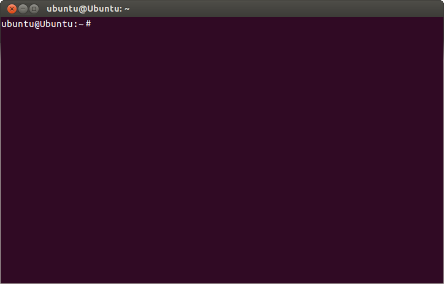

# Comandos básicos de Linux

Una breve guía introductoria a los comandos más utilizados en Linux, orientada a usuarios principiantes que desean aprender a manejar el sistema operativo desde el terminal.

## Índice

- [1. Introducción](#1-introducción)
- [2. Preparación del sistema](#2-preparación-del-sistema)
- [3. Comandos básicos](#3-comandos-básicos)
  - [3.1. date](#31-date)
  - [3.2. cal](#32-cal)
  - [3.3. who](#33-who)
- [4. Resumen de comandos](#4-resumen-de-comandos)
- [5. Conclusión](#5-conclusión)

---

## 1. Introducción

Linux es un sistema operativo que permite interactuar con el equipo mediante una interfaz gráfica o a través de la línea de comandos. El **terminal** es una herramienta fundamental para administrar el sistema, consultar información y ejecutar tareas de forma rápida y eficiente.

La sintaxis general de un comando sigue esta estructura:

`comando [-o | --opciones] [argumentos]`

Los elementos entre corchetes son opcionales. El símbolo `|` indica que se puede elegir entre dos alternativas, mientras que muchas opciones disponen de una forma corta, como `-h`, y otra larga, como `--help`.



## 2. Preparación del sistema

Antes de comenzar a utilizar los comandos, es recomendable comprobar que el sistema está actualizado. En distribuciones basadas en Debian o Ubuntu, como las que utilizan el gestor de paquetes APT, se pueden ejecutar las siguientes instrucciones:

```bash
sudo apt update
sudo apt upgrade
```

El primer comando actualiza la información de los paquetes disponibles, mientras que el segundo instala las actualizaciones correspondientes.

> **Nota:** El uso de `sudo` permite ejecutar una orden con privilegios de administrador. Por ello, conviene revisar las operaciones antes de confirmarlas.

## 3. Comandos básicos

A continuación, se presentan tres comandos sencillos que permiten consultar información sobre la fecha, el calendario y los usuarios conectados al sistema.

### 3.1. date

El comando `date` muestra la fecha y la hora actuales del sistema. También permite personalizar el formato de salida y, con los permisos adecuados, modificar la fecha y la hora.

Por ejemplo:

```bash
date
date "+%d/%m/%Y"
date "+%H:%M:%S"
```

- El primer comando muestra la fecha y la hora actuales.
- El segundo presenta la fecha en formato día/mes/año.
- El tercero muestra la hora, los minutos y los segundos.

### 3.2. cal

El comando `cal` muestra un calendario. Si se ejecuta sin argumentos, presenta el mes actual. También permite consultar meses y años concretos.

```bash
cal
cal 12 2026
cal 2026
```

El primer ejemplo muestra el calendario del mes actual; el segundo, diciembre de 2026; y el tercero, el año completo.

*Nota:* La disponibilidad de `cal` puede depender de los paquetes instalados en la distribución.

### 3.3. who

El comando `who` muestra información sobre los usuarios que tienen sesiones abiertas en el sistema, incluyendo datos como el nombre de usuario y el terminal utilizado.

```bash
who
who -H
```

La primera instrucción muestra los usuarios conectados. La opción `-H` añade encabezados a la información presentada.

Este comando resulta útil en equipos compartidos o servidores donde varias personas pueden iniciar sesión simultáneamente.

## 4. Resumen de comandos

La siguiente tabla recoge las principales características de los comandos explicados:

| Comando | Función principal | Ejemplo |
|---|---|---|
| `date` | Consultar la fecha y la hora | `date` |
| `cal` | Mostrar un calendario | `cal 12 2026` |
| `who` | Consultar los usuarios conectados | `who` |

Para ampliar los conocimientos sobre la terminal, se puede consultar esta [guía de comandos de Linux](https://www.freecodecamp.org/espanol/news/comandos-de-linux/).

## 5. Conclusión

Los comandos `date`, `cal` y `who` constituyen un buen punto de partida para familiarizarse con la terminal de Linux. Aunque sus funciones son sencillas, permiten comprender cómo se introducen instrucciones, se utilizan opciones y se consulta información del sistema.

Para seguir aprendiendo, se recomienda practicar estos comandos en un entorno seguro y explorar otras herramientas básicas, como `pwd`, `ls` y `cd`, que permiten conocer la ubicación actual y navegar por los directorios.

Con práctica y constancia, el uso de la línea de comandos se convierte en una habilidad útil para la administración y el mantenimiento de sistemas Linux. O no... Pero puede que sí.

